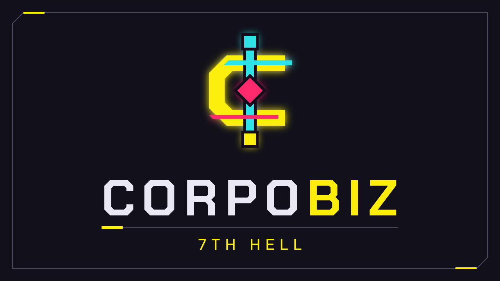

# CorpoBiz brand guide

## The mark

A chamfered **C** with a vertical bar cut through it. The bar makes the C read as a cent sign: currency, passive income. Three nodes run down the bar, one per tier of the supply chain the framework models, from raw materials through processing to retail.

| Node | Colour | Tier | Business |
|---|---|---|---|
| Top square | cyan | raw | Rustvale Farm |
| Centre diamond | magenta | processing | Watson Distillery |
| Bottom square | yellow | retail | 7th Hell |

Knockouts around the bar make it look sliced through the letter. On the logo card, two offset slices of the C add a glitch cut. The standalone icon omits them. Northside Warehouse buffers both goods, so it has no node of its own.

## Files

All generated by `make logos` (see below). Everything is 16:9 (1280×720) except the icon, which is square.

| File | Use |
|---|---|
| `assets/brand/logo.svg` / `.png` | Base logo, no business line |
| `assets/brand/icon.svg` / `.png` | Mark only, square (512px PNG) |
| `assets/brand/modules/<Module>.svg` / `.png` | One card per business |

Text in the SVGs is outlined, so they render the same everywhere with no fonts installed.

## Colour

| Name | Hex | Role |
|---|---|---|
| Signal yellow | `#FCEE0A` | The C, the **BIZ** half of the wordmark, 7th Hell |
| Data cyan | `#2DE2E6` | The bar, Rustvale Farm |
| Neon magenta | `#FF2A6D` | The centre node, Watson Distillery |
| Panel | `#12111B` | Background, and the knockout colour around the bar |
| Paper | `#EBE8F5` | The **CORPO** half of the wordmark, neutral business names |

The background and knockout colour must match, or the bar's cut-through effect breaks.

## Type

- **Wordmark:** Chakra Petch Bold, `CORPO` in paper and `BIZ` in yellow, stretched to a fixed 760-unit width.
- **Business line:** Chakra Petch Medium, uppercase, tracked at 0.32em, centred under the wordmark's rule.

Chakra Petch is licensed under the SIL Open Font License 1.1 (`tools/brand/OFL.txt`). The glyph outlines in `tools/brand/glyphs.json` are extracted from it.

## The business line

The line under the wordmark names the business, and takes the colour of that business's node. A business with no node of its own is set in the neutral paper colour. Long names shrink to stay inside the frame (the maximum width is 880 units).

## Adding a business

1. Add the module. Its `def.displayName` in `Def()` is the name that gets printed.
2. Optional: give it a colour by adding it to `ACCENTS` in `tools/brand/gen_logos.py`. Unlisted businesses use the neutral colour.
3. Run `make logos` and commit `assets/brand/`.

The `brand-logos-current` pre-commit hook fails if a module has no up-to-date logo, so a new business can't land without one. PNGs need `rsvg-convert` (librsvg) installed. Without it the SVGs are still written and the PNGs are skipped.

Names may use `A–Z`, `0–9`, space and `& ' - .`. For anything else, add the characters to `NAME_CHARS` in `tools/brand/extract_glyphs.py` and regenerate `glyphs.json` (needs `fonttools` and the Chakra Petch Medium and Bold files).

## Usage notes

- **Minimum size:** the icon reads clearly at 32px. At 16px it is only a rough silhouette, so use it there for favicons and nothing that needs the nodes to be distinguishable.
- **Colour:** don't recolour the mark. Only the business line changes colour per business.
- **Not yet covered:** one-colour (black or white) versions were explored in the concept but aren't generated. There is no horizontal lockup, and marketplace image requirements haven't been checked.
