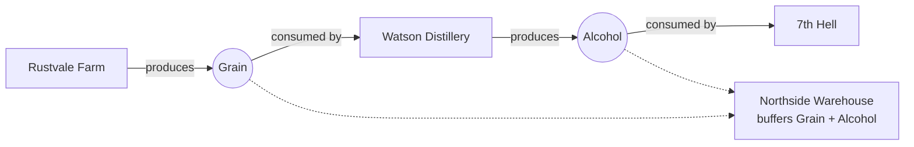

# CorpoBiz Framework

A Cyberpunk 2077 redscript mod, built on a small reusable framework
("CorpoBiz") for owning and running businesses in the city. 7th Hell (a
nightclub, Downtown/City Center) is the first business implemented on it:
after finishing the side gig "An Inconvenient Killer," the player can buy it
and run it from its in-world terminal — hire/fire staff, change their look,
restock, and collect revenue.

A four-business supply chain (Rustvale Farm grows Grain -> Watson
Distillery turns it into Alcohol -> Northside Warehouse buffers both ->
7th Hell sells the Alcohol) was prototyped as a browser-demo HTML/JS
mockup first, to work out the economics (production-vs-profit roles,
overflow-selling, a shared player wallet, security/theft risk) before any
of it touched redscript. Farm/Watson/Warehouse exist here now as real
`BizModule`s with that demo's role counts, hire costs, and resource
shapes carried over -- see each module's own file header for exactly
which parts of the demo's economics are (and, honestly, aren't yet)
represented by the current engine. None of the three have a real
in-world site picked out yet (`terminalPosition`/role `position` are
`(0,0,0,1)` placeholders) -- that's independent of everything else and
can be filled in whenever someone scouts locations.



(Dotted lines = Northside Warehouse's buffering role; actually moving a
resource between businesses isn't wired up yet -- see
[Inputs/outputs](#inputsoutputs-supply-chains--modeled-not-fully-playable-yet)
below.)

## How it's structured

- `base/` — the generic CorpoBiz framework (`module CorpoBiz`). Knows
  nothing about any specific business:
  - `Biz.reds` — the data model: `BizDef`, `BizPrereq`/`BizPrereqKind`,
    `BizRoleDef`.
  - `BizModule.reds` — the module contract: an `abstract class BizModule`
    every business implements (`Def()`, `GetRole()`,
    `RoleVariantCount/TemplatePath/Name`).
  - `Resource.reds` — the data model for a tradeable/consumable good
    (`abstract class Resource`, `SimpleResource`, `SupplyLevel`).
  - `CorpoBizState.reds` — Facts-backed persistence, namespaced by bizId
    (and role/resource id where relevant).
  - `CorpoBizPrereqs.reds` — checks a `BizDef`'s purchase gates (quest
    completion / player level / player stat).
  - `CorpoBiz.reds` — buy/hire/fire/restock/collect actions and lazy
    revenue + stock-decay accrual.
  - `Registry.reds` — the composition root: `CorpoBizRegistry`, a
    Codeware `ScriptableSystem` every module registers itself into.
  - `StaffSpawner.reds` — proximity-based spawn/despawn of hired staff,
    for every registered module.
  - `HostileCleanup.reds` — despawns leftover hostile NPCs in a venue
    once it's owned, for every registered module.
  - `TerminalUI.reds` — injects a "Biz" tab into any terminal whose
    position matches a registered module's business (see below).
- `modules/<BusinessName>/` — one folder per business, each
  independently installable:
  - `modules/7thHell/SeventhHell.reds` — the nightclub; real site, real
    gig-completion gate (checked against the actual journal state, not a
    self-asserted flag).
  - `modules/RustvaleFarm/RustvaleFarm.reds` — grows Grain; no site yet.
  - `modules/WatsonDistillery/WatsonDistillery.reds` — Grain -> Alcohol;
    no site yet.
  - `modules/NorthsideWarehouse/NorthsideWarehouse.reds` — buffers Grain
    and Alcohol; no site yet.
  - Each has its own `info.json` declaring a dependency on
    `CorpoBiz - Base`.

### Installing another business module

Add a new folder under `modules/` (Title-Case business name) with a class
extending `BizModule`, self-registering via the same `@wrapMethod
(ScriptedPuppet) OnGameAttached` pattern every existing module uses — see
any of the four current modules for the shape. Staff spawning, hostile
cleanup, and the terminal UI all pick it up automatically with no other
changes, since they only ever talk to modules through the `BizModule`
interface, and `make deploy`/`make compile` already loop over every
folder under `modules/`.

`TerminalUI.StaffDashboard` builds its role rows via count-based branching
rather than a loop (supports 0–4 roles) — `array<Struct>` has no `PushBack`
in this redscript build, so a fixed-size array literal is the only way to
return a variable number of rows; a module with more than 4 roles needs
another branch added there. All four current modules use exactly 4.

### Inputs/outputs (supply chains) — modeled, not fully playable yet

`BizDef.inputs`/`outputs: array<ref<Resource>>` name the goods a business
consumes/produces. `CorpoBiz.Settle` picks up the *first* input resource
automatically (fill-fraction-scaled revenue, per-active-role decay) — see
Watson Distillery's Grain for a business actually using that. Actually
moving a resource between businesses (the demo's `connections` object,
GTA Online-style supply runs) is intentionally not implemented yet; a
business with no inputs (Rustvale Farm, Northside Warehouse) just accrues
flat per-role revenue with no stock mechanic active. `outputs` on all
three new modules are forward-looking data only — nothing consumes them
yet.

## The terminal UI, and why it's built the way it is

There's no way to add a brand-new top-level tab widget to a computer
terminal without WolvenKit-authored UI assets. Instead, `TerminalUI.reds`
`@wrapMethod`s `ComputerInkGameController.InitializeMenuButtons` and
`InitializeMailsThumbnails` to:

- rebuild the top tab bar for *this specific terminal only* (matched by
  world position) as Web / Network / **Biz**, where "Biz" reuses the
  vanilla Mail tab's plumbing (`widgetName = "mails"`) so the game's own
  `GoToMenu` dispatch shows/hides it correctly;
- replace the Mail tab's contents with a small in-list menu (Home → Staff /
  Stock, with a "← Back" row), navigated via a persisted `UIView` fact.

Every row needs a **unique** `widgetName` (see `MakeEntry` in
`TerminalUI.reds`) — the game dedups cached widgets by
`ownerID+widgetName+widgetTweakDBID+libraryPath+libraryID`, not by document
address, so rows sharing a widgetName silently overwrite each other.

## Deploying to the game

**Do not use REDmod's own `mods/` + `redmod.exe deploy` pipeline** — in
testing (Steam/Proton on Linux) it reported success without ever actually
updating the compiled script cache. What actually works is the standalone
[redscript](https://github.com/jac3km4/redscript) package's auto-compile-at-launch
mechanism:

1. Install, in the Cyberpunk 2077 install directory:
   - [RED4ext](https://github.com/WopsS/RED4ext)
   - [Cyber Engine Tweaks](https://github.com/maximegmd/CyberEngineTweaks) (for live debugging via Facts/console; not required to just play)
   - [Codeware](https://github.com/psiberx/cp2077-codeware) (RED4ext plugin + its own `.reds` scripts)
   - standalone `redscript` (provides `engine/tools/scc.exe` and
     `engine/config/base/scripts.ini`) — this is what actually compiles
     `.reds` files at game launch.
2. Copy `base/` and every folder under `modules/` into
   `<game>/r6/scripts/` (so you end up with `r6/scripts/base/` and
   `r6/scripts/modules/<Name>/`).
3. Launch the game normally; redscript compiles automatically. Compile
   errors show as a blocking dialog in-game.

## Fast local iteration (no game launch needed)

`make compile` (see the `Makefile`) does steps 2–3 above for you, minus
actually launching the game: it deploys `base/` and every `modules/*/`
folder into `<game>/r6/scripts/`, then runs `engine/tools/scc.exe` (the
standalone redscript compiler, not REDmod's bundled one) directly:

```sh
wine engine/tools/scc.exe -compile r6/scripts \
  -compilePathsFile _scratch/paths_win.txt \
  -outputCacheFile _scratch/test.redscripts \
  r6/cache/final.redscripts
```

`_scratch/paths_win.txt` needs to list Codeware's `.reds` files
(`z:/`-prefixed, forward slashes) alongside `r6/scripts` so the compiler can
resolve Codeware types. This catches script errors in seconds instead of a
full game relaunch.

## Contributing

Checks run via [pre-commit](https://pre-commit.com). One-time setup after
cloning (installs the pre-commit, commit-msg and pre-push hooks):

```sh
pip install pre-commit  # or: pipx install pre-commit
pre-commit install
```

- **On commit:** secret/private-key scanning, plus grep checks for patterns
  the redscript compiler is known to reject (see `AGENTS.md`) and leftover
  debug instrumentation. The commit message must be a
  [conventional commit](#commit-messages-and-releases).
- **On push:** `make compile`, the only real type-check. It needs the game
  install (see [Fast local iteration](#fast-local-iteration-no-game-launch-needed))
  and skips itself if that isn't set up.
- **In CI:** the commit-time checks plus a full-history gitleaks scan. CI
  can't compile redscript -- `scc` needs the game's own `final.redscripts`.

### Commit messages and releases

Commit messages and PR titles are conventional commits:
`type(optional-scope): description`, with `type` one of `feat`, `fix`,
`perf`, `revert`, `docs`, `style`, `refactor`, `test`, `build`, `ci`,
`chore`. They drive the version number, so pick the type deliberately:

| Commit | Release |
|---|---|
| `feat: ...` | minor (0.1.0 → 0.2.0) |
| `fix: ...`, `perf: ...`, `revert: ...` | patch (0.1.0 → 0.1.1) |
| `feat!: ...` or a `BREAKING CHANGE:` footer | major (0.1.0 → 1.0.0) |
| `docs`, `style`, `refactor`, `test`, `build`, `ci`, `chore` | none |

This is a monorepo: **Base and each module are versioned independently.** A
component is `base` or a folder under `modules/` (e.g. `7thHell`), tagged
`<component>-vX.Y.Z` (`base-v0.2.0`, `7thHell-v0.1.1`). A commit counts toward
a component only if it touches that component's directory, so a `fix` in one
business doesn't release the others. A commit touching several components
counts for each. Changes outside every component (`tools/`, `assets/`, docs,
workflows) never release anything.

When a releasable commit lands on `main`, the Release workflow gives each
affected component its own GitHub release: the next version counted from that
component's last tag, notes grouped from its commits, then a build at that tag
with the zip attached (`CorpoBiz-Base-vX.Y.Z.zip`, `CorpoBiz-7th-Hell-vX.Y.Z.zip`,
...). A component with no tag yet publishes the version already in its
`info.json` on its first releasable commit. Each zip holds that mod's
`info.json` (version stamped to the release) and its sources under
`scripts/CorpoBiz/`, in the REDmod folder layout. The repo's own `info.json`
versions are only the seed for a first release and are never rewritten.

Modules declare which Base versions they work with in their own `info.json`
(`dependencies`). That range is edited by hand: a breaking Base release does
not update it for you, so bump the modules' constraint when Base breaks them.

If you squash-merge, set the repo's squash default to the PR title so the
merge commit is conventional. The gate is `tools/release/release.py`, which
also computes versions, so the two can't disagree. Build one component's zip
locally with `python3 tools/release/release.py build base 0.1.0` (output in
`dist/`, ignored by git).
